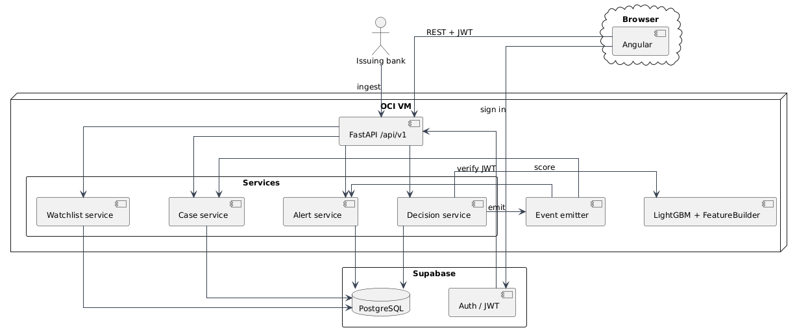
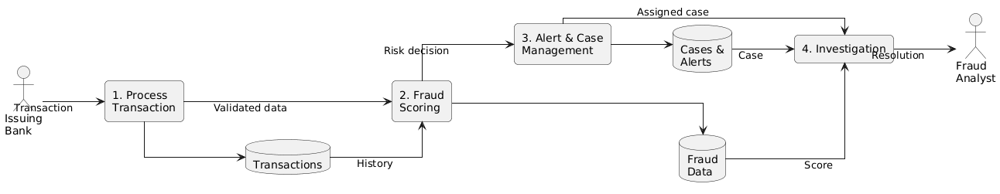
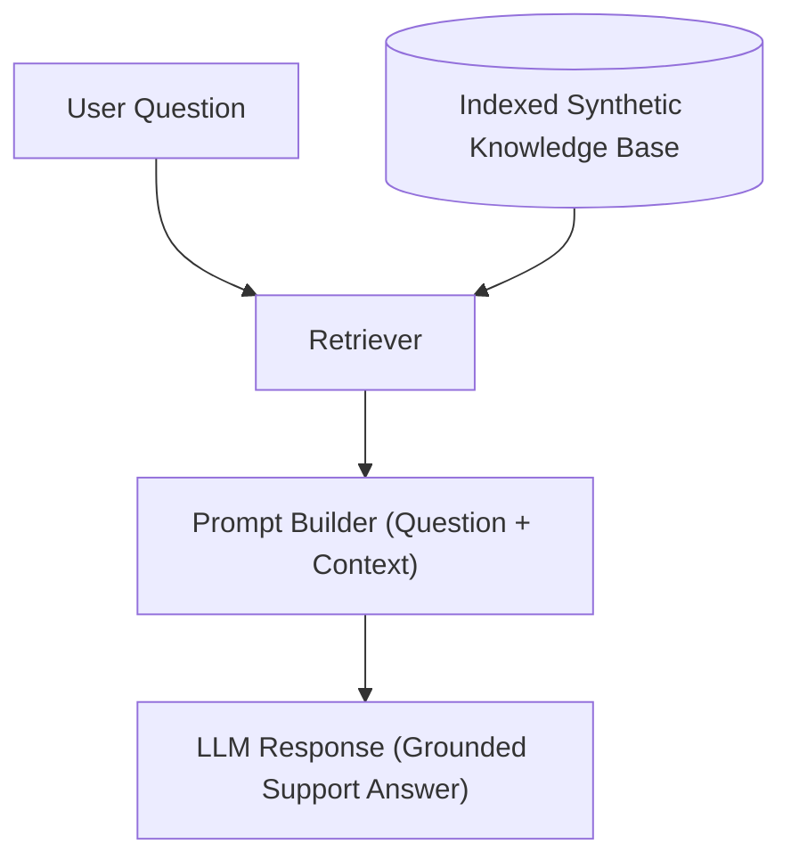

# FraudPulse

FraudPulse is a modular fraud detection platform for card payments. It combines machine learning, analytics, and a RAG-powered support assistant to help teams detect suspicious activity and act faster.

## Table of Contents

- [1. Overview](#1-overview)
- [2. Live Deployments](#2-live-deployments)
- [3. Getting Started](#3-getting-started)
  - [3.1 Backend](#31-backend)
  - [3.2 Frontend](#32-frontend)
  - [3.3 Tests](#33-tests)
- [4. Architecture](#4-architecture)
  - [4.1 Platform components](#41-platform-components)
  - [4.2 End-to-end fraud operations flow](#42-end-to-end-fraud-operations-flow)
- [5. Machine Learning](#5-machine-learning)
- [6. AI Support Assistant](#6-ai-support-assistant)
- [7. Features](#7-features)
  - [7.1 Core Capabilities](#71-core-capabilities)
  - [7.2 Back-office Processing](#72-back-office-processing)
  - [7.3 Investigation System](#73-investigation-system)
- [8. Technology Stack](#8-technology-stack)
- [9. Key Repository Structure](#9-key-repository-structure)
- [10. Development Workflow](#10-development-workflow)
- [11. Key Outputs](#11-key-outputs)
- [12. Team](#12-team)
- [13. License](#13-license)

## 1. Overview

FraudPulse is a modular fraud detection system that processes transactions, computes fraud risk scores, and classifies payments into **ALLOW**, **REVIEW**, or **BLOCK**. It is designed as an end-to-end workflow covering ingestion, scoring, decisioning, investigation, and monitoring.

**Supplementary documentation:** [deployed.md](deployed.md) (deployment guide) · [design-and-evaluation.md](design-and-evaluation.md) (architecture patterns and testing) · [ai-tooling.md](ai-tooling.md) (AI-assisted development notes) · [Requirement_Documents/](Requirement_Documents/) (SRS, functional and non-functional requirements, backlog)

## 2. Live Deployments

| Service            | URL                                                                            |
| ------------------ | ------------------------------------------------------------------------------ |
| Frontend           | [https://fraudpulse-u2va.onrender.com/](https://fraudpulse-u2va.onrender.com/) |
| Backend (API docs) | [https://fraudpulse.duckdns.org/docs](https://fraudpulse.duckdns.org/docs)     |
| Backend (health)   | [https://fraudpulse.duckdns.org/health](https://fraudpulse.duckdns.org/health) |

The public landing page, the model demo, and the AI support assistant are open to anyone — no sign-in required. The analyst dashboard (cases, alerts, watchlist, back-office tools) is behind authentication; please contact a maintainer for reviewer access.

## 3. Getting Started

```bash
git clone https://github.com/FraudPulseLabs/FraudPulse.git
cd FraudPulse
```

### 3.1 Backend

Run from the `backend/` directory. Use **Python 3.11 or 3.12** (the RAG assistant depends on `torch`, which has no wheels for 3.14).

```bash
cd backend
python3.11 -m venv .venv
source .venv/bin/activate          # Windows: .venv\Scripts\activate
pip install --upgrade pip
pip install -r requirements.txt
cp .env.example .env               # then set DATABASE_URL
python run.py
```

The API serves versioned routes under `/api/v1`, with docs at `http://localhost:8000/docs` and a health probe at `http://localhost:8000/health`. The app starts without `DATABASE_URL`, but routes that need Postgres will be unavailable.

To enable the RAG assistant, also install the extras and build the index:

```bash
pip install torch --index-url https://download.pytorch.org/whl/cpu   # CPU-only, avoids large CUDA packages
pip install -r requirements-rag.txt
python -m rag.scripts.build_vector_db
```

Full details: [backend/README.md](backend/README.md) · [backend/rag/README.md](backend/rag/README.md)

### 3.2 Frontend

```bash
cd frontend
npm install
npm start                          # http://localhost:4200
```

Full details: [frontend/README.md](frontend/README.md)

### 3.3 Tests

```bash
cd backend  && pytest              # 200+ unit and integration tests
cd frontend && npm test            # Jest unit and component tests
```

## 4. Architecture

FraudPulse architecture is described at two levels: **what the platform is built from** (components) and **how a transaction moves through the system** (operational flow). The **ML fraud engine is the primary decision layer**; the **RAG assistant is a secondary support capability**.

### 4.1 Platform components

- **Angular frontend**: user dashboards, case views, and support assistant interface
- **FastAPI backend**: fraud APIs, decisioning endpoints, and service orchestration
- **ML fraud detection engine (primary)**: risk scoring, prediction, and fraud classification
- **Analytics services**: trends, metrics, and back-office monitoring
- **RAG-powered AI support assistant**: context retrieval and grounded natural-language responses



### 4.2 End-to-end fraud operations flow

- **Transaction Ingestion API**: receives and validates transactions
- **Fraud Scoring Engine**: computes risk (rules + ML)
- **Decision Engine**: classifies transactions
- **Data Layer**: stores transactions, scores, and cases
- **Back-office Processor**: re-evaluates and detects long-range patterns
- **Case Management System**: supports investigation workflows
- **Dashboard**: monitoring and analytics UI



## 5. Machine Learning

FraudPulse’s ML capabilities form the primary fraud intelligence layer for both real-time and back-office fraud operations.

- **Fraud prediction**: estimates probability of fraudulent activity per transaction
- **Risk scoring**: produces normalized fraud scores to support decision thresholds
- **Explainability**: `POST /api/v1/transactions?explain=true` returns per-feature SHAP contributions for a score
- **Pattern analysis**: identifies suspicious trends and recurring behavior across events
- **Hybrid decisioning**: combines ML and rules for robust **ALLOW/REVIEW/BLOCK** outcomes

The deployed model is a tuned, calibrated **LightGBM** classifier (32 features, 64,762 training rows) scoring **ROC-AUC 0.966 / PR-AUC 0.721** on a held-out test set at 3.3% fraud prevalence. Rather than a single cut-off, calibrated scores are mapped to three outcomes, which puts **89% of fraud in front of either an automatic decline or an analyst** while sending ~9.7% of traffic to review.

Full metrics, hyperparameters, threshold analysis, and the earlier modelling iterations: [backend/ml/MODEL_EVALUATION.md](backend/ml/MODEL_EVALUATION.md)

## 6. AI Support Assistant

The AI support assistant is a secondary support layer for product guidance and operational help. It uses RAG to provide context-aware responses and does not replace the core ML-based fraud decisioning pipeline.

- **RAG architecture**: combines context retrieval with LLM generation for grounded answers
- **Knowledge base**: currently uses curated synthetic support content indexed for domain-specific responses
- **Workflow**:
  1. User submits a question
  2. Relevant context is retrieved from the indexed knowledge base
  3. Retrieved context is injected into the LLM prompt
  4. The LLM generates a context-grounded answer
- **Rate limiting**: public assistant, demo, and access-request endpoints are capped per client IP (HTTP `429` when exceeded); analyst APIs behind JWT are not.



## 7. Features

### 7.1 Core Capabilities

- Real-time transaction ingestion
- Fraud risk scoring
- Rule-based + ML-based detection
- Automated decisioning (**ALLOW / REVIEW / BLOCK**)
- Case creation from alerts

### 7.2 Back-office Processing

- Event reprocessing
- Fraud pattern detection
- Batch evaluation of transactions

### 7.3 Investigation System

- Case lifecycle management
- Alert grouping
- Analyst workflow support

## 8. Technology Stack

- **Frontend**: Angular 21 (zoneless, signal-based state), Jest
- **Backend**: FastAPI, Python REST services, SQLAlchemy, pytest
- **AI/RAG**: retrieval pipeline, FAISS vector index, LLM-based response generation
- **Machine Learning**: fraud classification and risk-scoring models, SHAP explainability
- **Data & Infrastructure**: Supabase Postgres, Supabase Auth (JWT), Docker, Nginx, CI/CD with GitHub Actions

## 9. Key Repository Structure

```text
.
├── backend/                 -> FastAPI API, ML engine, RAG services, tests
├── frontend/                -> Angular application (UI, routing, feature modules)
├── Requirement_Documents/   -> SRS, requirements, user stories and backlog
├── .github/                 -> CI workflows and project automation
├── ai-tooling.md            -> team AI tooling notes
├── deployed.md              -> deployment guide
├── design-and-evaluation.md -> architecture patterns and testing documentation
├── render.yaml              -> deployment configuration
└── README.md                -> project documentation
```

## 10. Development Workflow

Planning, sprint tasks, and delivered features are tracked on the team's Trello Scrum board: [MSSE Capstone — Payment Card Fraud Detection System](https://trello.com/b/JOTRnC13/msse-capstone-project-payment-card-fraud-detection-system). The board documents user stories, work in progress, completed features, and backlog items across the FraudPulse delivery.

Branch protection on `main`:

- No direct pushes to `main`
- All changes require Pull Requests
- At least 1 approval required
- CI checks must pass before merge

## 11. Key Outputs

- Fraud risk score (0–1)
- Decision: `ALLOW` / `REVIEW` / `BLOCK` (API: `APPROVE` / `APPROVE_WITH_REVIEW` / `DECLINE`)
- Case creation for flagged transactions

## 12. Team

- [**Macharia Kibandi**](https://github.com/KibandiMacharia "KibandiMacharia by GitHub") · Project Owner
- [**Victor Asena**](https://github.com/namema1 "namema1 on GitHub") · Technical Lead & Scrum Master
- [**Olalekan Erinoso**](https://github.com/lagjracia "lagjracia on GitHub") · Team Member
- [**James Kilonzo**](https://github.com/KilonzoJames "KilonzoJames on GitHub") · Team Member

For AI-assisted development notes, see [ai-tooling.md](ai-tooling.md).

## 13. License

FraudPulse is licensed under the **MIT License** — see [LICENSE](LICENSE). You may use, modify, and distribute the software with minimal restrictions.
